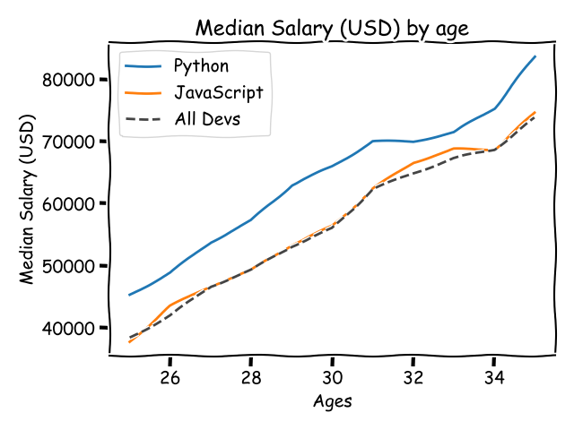

# Learning Lab

> *Personal learning playground: Python data visualization, Pygame games, Django web apps and Web3.py experiments.*

Recueil de mes exercices et mini-projets d'apprentissage, du lycée à la licence (2020 → aujourd'hui). Certains ont été réalisés en suivant des cours ou des tutoriels, puis adaptés. Mes projets principaux sont dans des dépôts séparés (voir mon profil).



## Contenu

| Dossier | Description | Technologies |
|---|---|---|
| [`data-viz/matplotlib-basics`](data-viz/matplotlib-basics) | Courbes, barres, camemberts et aires empilées sur des données de salaires et de l'enquête Stack Overflow | Python, Matplotlib, CSV |
| [`games/flappy-bird`](games/flappy-bird) | Clone de Flappy Bird : gravité, défilement, collisions, score | Python, Pygame |
| [`games/space-duel`](games/space-duel) | Duel spatial à 2 joueurs sur le même clavier : tirs, points de vie, sons | Python, Pygame |
| [`games/platformer`](games/platformer) | Personnage animé (sprites gauche / droite), saut et déplacements | Python, Pygame |
| [`django/todo-app`](django/todo-app) | Liste de tâches : création, modification, suppression (CRUD) | Django, formulaires, SQLite |
| [`django/crm-dashboard`](django/crm-dashboard) | Mini-CRM : clients, produits, commandes, tableau de bord et statuts | Django ORM, templates |
| [`django/ecommerce-store`](django/ecommerce-store) | Boutique en ligne : catalogue, panier, page de paiement | Django, JavaScript |
| [`django/saporito-caffe`](django/saporito-caffe) | Site vitrine et boutique pour un café : accueil, boutique, panier, commande, contact | Django, modèles Customer / Product / Order |
| [`django/music-controller-api`](django/music-controller-api) | API REST de salons d'écoute partagée | Django REST Framework |
| [`web3/web3py-basics`](web3/web3py-basics) | Lecture de la blockchain Ethereum, transactions et contrats sur un réseau local Ganache | Python, Web3.py |
| [`web3/simple-storage-deploy`](web3/simple-storage-deploy) | Compilation et déploiement d'un smart contract Solidity | Solidity, py-solc-x, Web3.py |

## Lancer un projet

```bash
# Jeux et graphiques
pip install pygame matplotlib
python games/flappy-bird/flappy_bird.py

# Projets Django
pip install django djangorestframework
cd django/todo-app && python manage.py migrate && python manage.py runserver
```

Les projets Web3 lisent leurs paramètres dans les variables d'environnement (`INFURA_URL`, `PRIVATE_KEY…`) et sont prévus pour un réseau de test local (Ganache), jamais avec de vraies clés.

---

**Luca Raciti** · [LinkedIn](https://www.linkedin.com/in/raciti-luca)
